<p align="center">
  
</p>


### `▍01` // O QUE É ESTA CONTA

> **Conta oficial de QA da Afterlife RP.**
> Aqui recebemos, revisamos e testamos o código dos devs parceiros antes de qualquer coisa entrar no servidor.
> Toda entrega fica registrada em Pull Request, com histórico, comentários e resultado da revisão. **Transparência total.**


### `▍02` // PROTOCOLO

<p align="center">
  
</p>


### `▍03` // REGRAS DE ACESSO

```diff
+ [OK]   Código legível, com dependências e versões declaradas
+ [OK]   Configs com valores de exemplo (config.example)
+ [OK]   SQL de criação das tabelas junto com a entrega
+ [OK]   Entregas grandes divididas em capítulos: um PR por capítulo

- [NEGADO]  Tokens, senhas, webhooks ou connection strings no código
- [NEGADO]  Arquivos ofuscados ou criptografados sem combinar antes
- [NEGADO]  Binários e scripts (.exe .dll .bat .ps1) sem justificativa
- [NEGADO]  Chamadas externas escondidas (HTTP, downloads, webhooks)
```


### `▍04` // TERMINAL

```console
afterlife@qa:~$ status --devs
  ▸ devs parceiros ......... conectados via Pull Request
  ▸ ambiente de QA ......... isolado
  ▸ revisão de segurança ... obrigatória
  ▸ deploy no servidor ..... só após aprovação

afterlife@qa:~$ █
```

<p align="center">
  
</p>
